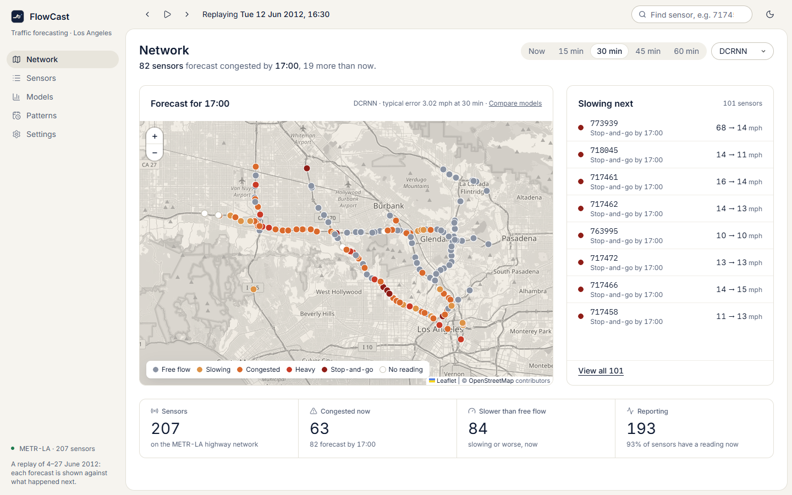
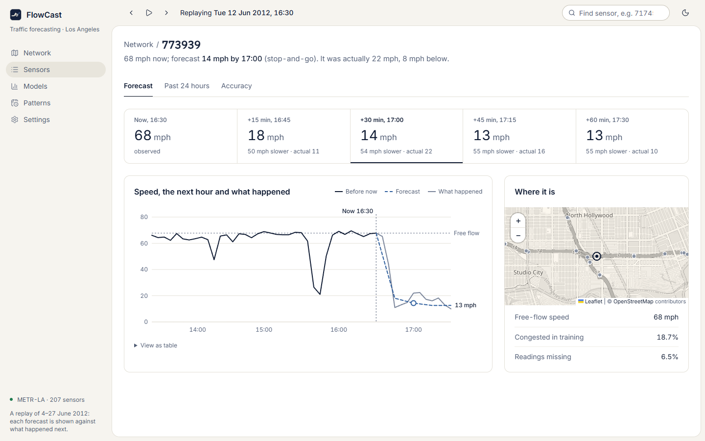
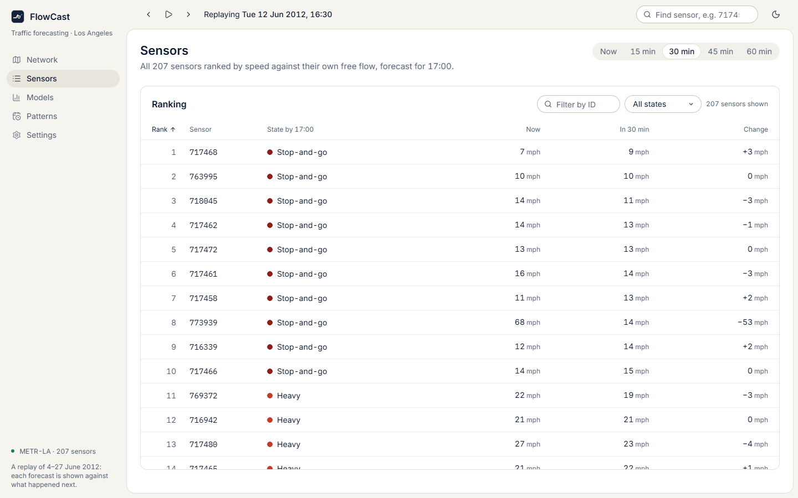
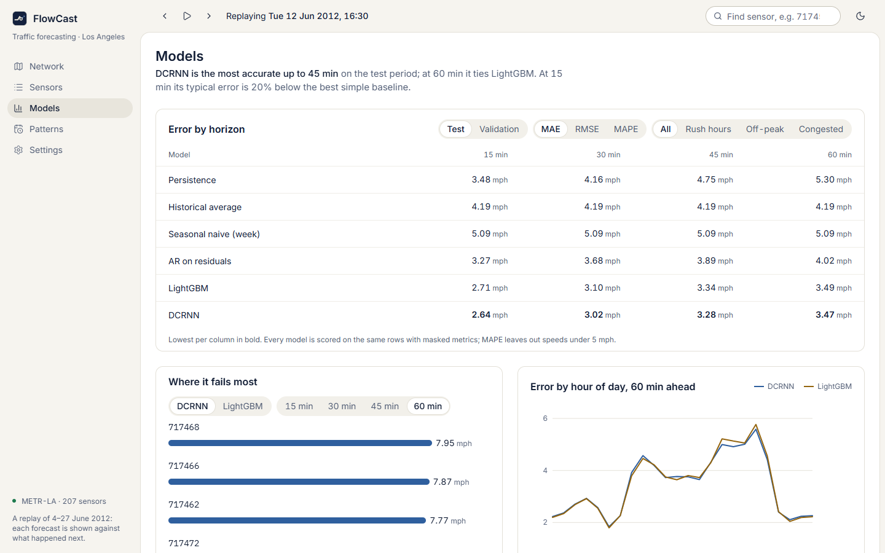
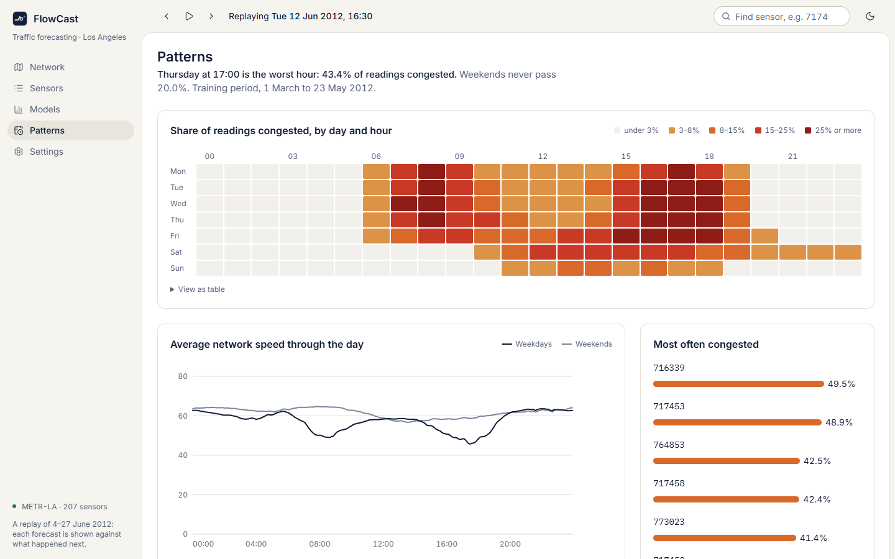
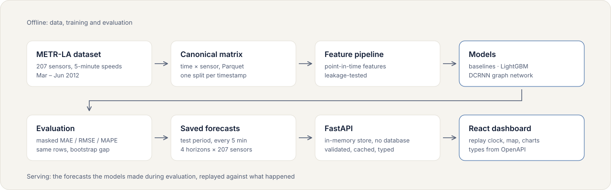

<picture>
  <source media="(prefers-color-scheme: dark)" srcset="docs/assets/flowcast-hero-dark.svg" />
  <source media="(prefers-color-scheme: light)" srcset="docs/assets/flowcast-hero-light.svg" />
  
</picture>

<p align="center">
  
  
  
  
  
  
  
  
</p>

## Overview

FlowCast forecasts highway traffic speed **15, 30, 45 and 60 minutes ahead** for the 207 loop-detector sensors of the METR-LA dataset (Los Angeles, 5-minute readings, March to June 2012).

It is a complete, tested pipeline: data reconstruction and validation, leakage-tested features, four baselines, a LightGBM forecaster and a DCRNN graph neural network, all scored on identical rows. A FastAPI backend serves the forecasts, and a React dashboard **replays June 2012**: pick any moment, and every forecast is drawn against what actually happened next.

The data is historical. Nothing in the app is live, and nothing is simulated.

## Key capabilities

- **Replay clock.** Step or play through 4 to 27 June 2012 in 5-minute steps. The time, horizon and model live in the URL, so every view can be shared.
- **Network map.** All 207 sensors coloured by forecast severity against each sensor's own free-flow speed.
- **Forecast against reality.** Per sensor: the observed history, the dashed forecast for the next hour, and the speeds that followed.
- **Honest model comparison.** Every model on the same rows with masked metrics, plus a day-block bootstrap that says where the difference between the two learned models is real.
- **Dark and light themes** that follow the system by default, in the app and in this README.

## Dashboard preview

<picture>
  <source media="(prefers-color-scheme: dark)" srcset="docs/assets/screens/network-dark.png" />
  <source media="(prefers-color-scheme: light)" srcset="docs/assets/screens/network-light.png" />
  
</picture>

All screenshots are captured from the running application by [`frontend/scripts/screenshots.mjs`](frontend/scripts/screenshots.mjs), at the replay time Tuesday 12 June 2012, 16:30, with DCRNN's 30-minute forecast.

## Features

### Forecasting interface

Sensor 773939 is at 68 mph at 16:30. DCRNN forecasts 14 mph by 17:00. It was actually 22 mph.

<picture>
  <source media="(prefers-color-scheme: dark)" srcset="docs/assets/screens/forecast-dark.png" />
  <source media="(prefers-color-scheme: light)" srcset="docs/assets/screens/forecast-light.png" />
  
</picture>

### Sensor ranking

Every sensor ranked by speed against its own free flow, sortable and filterable by state or ID.

<picture>
  <source media="(prefers-color-scheme: dark)" srcset="docs/assets/screens/sensors-dark.png" />
  <source media="(prefers-color-scheme: light)" srcset="docs/assets/screens/sensors-light.png" />
  
</picture>

### Model performance

<picture>
  <source media="(prefers-color-scheme: dark)" srcset="docs/assets/screens/models-dark.png" />
  <source media="(prefers-color-scheme: light)" srcset="docs/assets/screens/models-light.png" />
  
</picture>

### Traffic patterns

When and where congestion happens, computed from the training period only.

<picture>
  <source media="(prefers-color-scheme: dark)" srcset="docs/assets/screens/patterns-dark.png" />
  <source media="(prefers-color-scheme: light)" srcset="docs/assets/screens/patterns-light.png" />
  
</picture>

## How FlowCast works

1. **Rebuild the timeline.** The published dataset is a set of overlapping windows. FlowCast rebuilds one canonical (time × sensor) speed matrix from them and validates it.
2. **Split by time.** Train, validation and test are consecutive periods, and each timestamp belongs to exactly one.
3. **Build point-in-time features.** Every feature for time *t* uses only readings at or before *t*. A test perturbs the future and asserts the features do not change.
4. **Train and compare.** Baselines, LightGBM and DCRNN are scored on the same rows with the same masked metrics. The test period is scored once per model.
5. **Serve the evaluated forecasts.** The API serves exactly the test-period forecasts the models produced, so what the dashboard shows is what the metrics measured.

## System architecture

<picture>
  <source media="(prefers-color-scheme: dark)" srcset="docs/assets/architecture-dark.svg" />
  <source media="(prefers-color-scheme: light)" srcset="docs/assets/architecture-light.svg" />
  
</picture>

There is no database: the data is static and small, so the API holds it in memory. The full design is in [docs/architect.md](docs/architect.md).

## Dataset

| | |
|---|---|
| Source | METR-LA (Los Angeles County highway loop detectors), loaded from Hugging Face |
| Sensors | 207, with coordinates and a published directed road graph |
| Resolution | One speed reading (mph) every 5 minutes |
| Training period | 1 March to 23 May 2012 |
| Validation period | 23 May to 4 June 2012 |
| Test period | 4 to 27 June 2012 (the period the dashboard replays) |
| Missing readings | Recorded as 0 in the source; treated as missing and excluded from every loss and metric |

Details and verified statistics: [docs/dataset.md](docs/dataset.md) and [docs/eda.md](docs/eda.md).

## Machine learning methodology

| Model | What it is |
|---|---|
| Persistence | Speed stays as it is now |
| Historical average | The sensor's usual speed for this weekday and time of day |
| Seasonal naive | The reading one week earlier |
| AR on residuals | An autoregression on the deviation from the historical average (the best baseline) |
| LightGBM | One global gradient-boosted model per horizon on 39 point-in-time features |
| DCRNN | A diffusion-convolutional recurrent network over the road graph; one model forecasts 12 steps |

- **Masked metrics.** Missing targets are excluded, so no model looks better by skipping hard rows. MAPE leaves out speeds under 5 mph.
- **Congestion is relative.** A sensor is congested below 60% of its own free-flow speed (its 85th-percentile training speed), because free-flow speeds range from 36 to 70 mph.
- **Published settings for DCRNN**, not tuned for this split; one training run per learned model.

## Forecasting horizons

Forecasts are made for 15, 30, 45 and 60 minutes ahead (3, 6, 9 and 12 five-minute steps). Error grows with the horizon for every model, and the advantage of the graph model shrinks with it.

## Model evaluation

Mean absolute error in mph on the **test period**, lower is better. Every number comes from the committed JSON in [`models/metrics/`](models/metrics).

| Model | 15 min | 30 min | 45 min | 60 min |
|---|---:|---:|---:|---:|
| Persistence | 3.48 | 4.16 | 4.75 | 5.30 |
| Historical average | 4.19 | 4.19 | 4.19 | 4.19 |
| Seasonal naive (week) | 5.09 | 5.09 | 5.09 | 5.09 |
| AR on residuals | 3.27 | 3.68 | 3.89 | 4.02 |
| LightGBM | 2.71 | 3.10 | 3.34 | 3.49 |
| **DCRNN** | **2.64** | **3.02** | **3.28** | **3.47** |

What the results do and do not show:

- DCRNN has the lowest MAE at every horizon. A day-block bootstrap finds the gap to LightGBM is real at 15, 30 and 45 minutes and **not distinguishable at 60 minutes**.
- The gain is concentrated in congestion: on congested validation targets DCRNN is about 1 mph better than LightGBM at every horizon.
- On RMSE the picture is mixed: at 45 and 60 minutes on the test period LightGBM is better, so DCRNN's rare large misses are slightly worse.
- Each learned model was trained once. The intervals cover day-to-day variation, not training randomness.

Full analysis: [docs/experiments.md](docs/experiments.md) and [docs/model_comparison.md](docs/model_comparison.md). Model cards: [LightGBM](docs/model_card_lightgbm.md), [DCRNN](docs/model_card_dcrnn.md).

## Technology stack

| Layer | Technology |
|---|---|
| Data and features | Python 3.12, pandas, NumPy, PyArrow |
| Models | LightGBM, PyTorch (DCRNN, mixed precision on a 6 GB GPU) |
| Backend | FastAPI, Pydantic, Uvicorn |
| Frontend | React 19, TypeScript (strict), Vite, TanStack Query, React Router, Leaflet |
| Styling and charts | Plain CSS design tokens; hand-written SVG charts |
| Quality | pytest, Ruff, Vitest, TypeScript type-checking |

## Project structure

```text
src/flowcast/
  data/          load, reconstruct and validate METR-LA
  features/      point-in-time features and targets
  models/        baselines, LightGBM, DCRNN
  evaluation/    masked metrics, shared evaluation rows, results loader
  api/           FastAPI app, in-memory forecast store, response schemas
scripts/         one script per pipeline step (prepare, features, train, compare, benchmark)
tests/           91 tests: synthetic unit tests and real-data integration tests
frontend/
  src/screens/     Network, Sensors, Sensor, Models, Patterns, Settings
  src/components/  shell, map, charts, controls
  src/lib/         API client, replay state, severity bands, formatting, theme
  src/styles/      tokens.css (design tokens), app.css
docs/            dataset, EDA, features, experiments, model cards, architecture
models/metrics/  committed evaluation results (JSON)
```

## Installation

Requires Python 3.12 and Node 22 or later. Commands are for Windows PowerShell.

```powershell
git clone https://github.com/lloydaq/flowcast.git
cd flowcast
py -3.12 -m venv .venv
.\.venv\Scripts\Activate.ps1
pip install -r requirements.txt
cd frontend; npm install; cd ..
```

The data and the model outputs are not in the repository. Rebuild them once:

```powershell
python scripts/prepare_metr_la.py   # downloads ~230 MB, writes data/processed/
python scripts/build_features.py    # point-in-time feature tables
python scripts/run_baselines.py     # baseline scores
python scripts/train_lightgbm.py    # about 60 minutes on CPU
pip install torch --index-url https://download.pytorch.org/whl/cu126
python scripts/train_dcrnn.py       # about 3.7 hours on an RTX 3050; --resume continues after an interruption
python scripts/compare_models.py    # side-by-side table and bootstrap significance
```

## Local development

```powershell
uvicorn flowcast.api.app:app        # API on http://127.0.0.1:8000
cd frontend
npm run dev                         # dashboard on http://localhost:5173, proxies /api to the API
```

`npm run build; npm run preview` serves the production build on http://localhost:4173. A view is a URL, for example `/sensor/773939?t=2012-06-12T16:30&h=30&m=dcrnn`.

## API documentation

Interactive OpenAPI documentation is served at `http://127.0.0.1:8000/docs`. All endpoints are read-only.

| Endpoint | Returns |
|---|---|
| `GET /api/health` | Models, replay range, horizons |
| `GET /api/sensors`, `/api/sensors/{id}` | Sensor locations, free-flow speed, training statistics |
| `GET /api/forecast?as_of=&horizon=&model=` | The whole network at one horizon: speed now, forecast, actual |
| `GET /api/forecast/{id}?as_of=&history_hours=` | One sensor: history, four forecasts, and the hour that followed |
| `GET /api/models`, `/api/metrics`, `/api/metrics/sensors` | Model registry, all scores, per-sensor error |
| `GET /api/analytics/daily-profile`, `/weekly-congestion` | Training-period patterns |

Invalid input returns 422 with a reason; an unknown sensor returns 404. Measured latency for the network forecast is 4.7 ms at the 95th percentile over local HTTP ([`api_latency.json`](models/metrics/api_latency.json)).

## Testing

```powershell
pytest                    # 91 tests
ruff check . ; ruff format --check .
cd frontend
npm test                  # 10 unit tests
npm run typecheck
node scripts/screenshots.mjs   # recaptures the README screenshots; fails on console errors or overflow
```

Real-data tests are skipped until `prepare_metr_la.py` has been run. There is no hosted CI yet.

## Roadmap

- [x] Dataset reconstruction, validation and exploratory analysis
- [x] Leakage-tested features, baselines and the evaluation framework
- [x] LightGBM and DCRNN, compared with bootstrap significance
- [x] FastAPI backend and React dashboard
- [ ] End-to-end tests and a security review
- [ ] Public demo deployment
- [ ] Calibrated prediction intervals
- [ ] Corridor time-space diagram

Phase-by-phase status and exit criteria: [docs/phases.md](docs/phases.md).

## Contributing

Issues and pull requests are welcome. Please keep the project's rules: numbers in documents come from committed JSON written by scripts, new features need a leakage test, and `pytest`, `ruff` and the frontend checks must pass.

## Citation and license

METR-LA was introduced in Li et al., *Diffusion Convolutional Recurrent Neural Network: Data-Driven Traffic Forecasting* (ICLR 2018). Map data © OpenStreetMap contributors.

FlowCast is released under the [MIT License](LICENSE).
