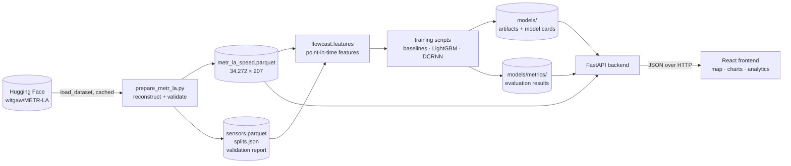

# FlowCast — Architecture

Status: **living document**. Sections marked *(decided)* are settled. Sections marked *(proposed)* are the current plan and are confirmed in the phase that builds them. Last updated 2026-11-08 (after Phase 2).

Related: [phases.md](phases.md) (roadmap), [memory.md](memory.md) (facts and decisions log), [dataset.md](dataset.md), [eda.md](eda.md).

---

## 1. Purpose and constraints

FlowCast forecasts highway speed 15 / 30 / 45 / 60 minutes ahead for the 207 METR-LA sensors in Los Angeles, and presents those forecasts in an interactive web application.

| Constraint | Consequence for the architecture |
|---|---|
| Budget ₹0 | Only free and open-source tools. No paid APIs, cloud GPUs or hosted databases. Map tiles use a free tier with attribution. |
| Laptop: Ryzen 7 7840HS, 16 GB RAM, RTX 3050 6 GB | LightGBM on CPU. Deep-learning batch size limited to 6 GB of VRAM. No component may need the full 2.8 GB windowed dataset in RAM. |
| Windows 11 + PowerShell | Everything runs natively without Docker. Docker is optional. |
| Historical dataset (Mar–Jun 2012) | There is no live feed. The app runs on a **replay clock** (§3). |

## 2. System overview



One Python package (`src/flowcast`) holds all ML logic. The backend imports it and does not re-implement any of it. The frontend talks only to the backend.

| Layer | Location | Owns |
|---|---|---|
| Data *(decided, built)* | `src/flowcast/data/` | Acquisition, reconstruction, validation, access to processed files |
| Analysis *(built)* | `src/flowcast/analysis/` | EDA statistics |
| Features *(Phase 3)* | `src/flowcast/features/` | Point-in-time feature generation, leakage guards |
| Models *(Phases 4–6)* | `src/flowcast/models/` | Baselines, LightGBM, graph models, behind one predict interface |
| Evaluation *(Phase 4)* | `src/flowcast/evaluation/` | Masked metrics, slicing (horizon, peak, congested, sensor) |
| Forecasting service *(Phase 7)* | `src/flowcast/forecasting/` | "Forecast at time *t*" for any model: gathers history ≤ *t*, builds features, predicts |
| Backend *(Phase 7)* | `backend/app/` | HTTP, validation, caching, error handling. No ML logic. |
| Frontend *(Phase 8)* | `frontend/` | The user interface (§9–§10) |

## 3. The replay clock *(decided)*

METR-LA ends on 2012-06-27, so there is no "now" to forecast from. FlowCast simulates one:

- Every forecast request carries an **as-of time** `t` inside the **test period** (2012-06-04 04:10 → 2012-06-27 23:55). Using the test period means the app never shows forecasts on data the model was trained or tuned on.
- The forecasting service may read only readings with timestamp ≤ `t`. This is the same rule the feature pipeline enforces in training, applied at serving time.
- Because the future is actually known, the app can show **forecast vs what really happened** at every horizon. That is the honest way to show accuracy, and it is the product's most distinctive view.
- The frontend presents this openly: a replay-time control labelled "Replaying 12 Jun 2012, 17:05". It never claims to be live.

## 4. Data and artifacts *(decided for Phases 1–2)*

| Artifact | Format | Size | Produced by | In git? |
|---|---|---|---|---|
| HF windowed splits | Arrow (memory-mapped HF cache) | ~2.8 GB | `load_dataset` | no |
| Canonical speed matrix | Parquet, float64, 0 = missing | 9.6 MB | `scripts/prepare_metr_la.py` | no (reproducible) |
| Sensor metadata, splits, validation report | Parquet / JSON | < 1 MB | same | no |
| EDA figures and summary | PNG / JSON | ~0.6 MB | `scripts/run_eda.py` | **yes** (they are documentation) |
| Feature tables | Parquet, float32, one file per split | estimated ≤ 1.5 GB | Phase 3 | no |
| Model artifacts | LightGBM text / PyTorch `state_dict` | MBs | Phases 5–6 | no (rebuild script + model card instead) |
| Evaluation results | JSON / Parquet | small | Phases 4–6 | **yes** (the numbers in the docs must be traceable) |

**Invariant:** every number in `docs/` comes from a committed JSON file produced by a script. No numbers are typed into documents by hand.

## 5. ML architecture

### 5.1 Point-in-time features *(Phase 3, proposed)*

A training row is (sensor, as-of time `t`). Its target is the speed at `t + h` for h ∈ {3, 6, 9, 12} steps.

- **Leakage rule:** every feature for row `t` is a function of readings at timestamps ≤ `t`. This is enforced in code by computing features on series that are explicitly shifted, never centred, and verified by a test: perturb every reading after `t`, then assert the features for `t` do not change.
- **Missing data:** readings of 0 become NaN. Features keep NaN; LightGBM handles it natively. Missing-indicator features are added. Nothing is forward-filled across gaps longer than 15 minutes.
- **Split assignment:** a row belongs to the split that owns all of its target timestamps (`metr_la_splits.json`). Rows whose targets cross a split boundary are dropped. Phase 1 counted 12 per boundary.
- **Targets that are missing** (0 in the raw data) are excluded from loss and metrics: masked training and masked evaluation.

### 5.2 Models

| Model | Role | Status |
|---|---|---|
| Persistence | Floor: "speed stays as it is now" | Phase 4 |
| Historical average by (sensor, day of week, time slot), training data only | Floor: "a typical day" | Phase 4 |
| A simple statistical model (e.g. per-sensor seasonal AR), chosen in Phase 4 | Statistical reference | Phase 4 |
| **LightGBM, one global model per horizon** *(proposed)* | Main model | Phase 5 |
| DCRNN (then possibly STGCN / Graph WaveNet) | Graph model on the published directed adjacency | Phase 6 |

Why **one global model per horizon** and not one model per sensor: each sensor has only about 24k training rows, and the EDA showed that sensors share daily and weekly structure. A global model with sensor-level features (node id as a categorical, free-flow speed from training data) pools that information. Separate horizon models keep each target simple and let the error be studied per horizon. This is decided with evidence in Phase 5 by comparing it against a multi-output alternative on validation.

All models implement one interface:

```python
class Forecaster(Protocol):
    name: str
    horizons: tuple[int, ...]           # steps ahead: (3, 6, 9, 12)
    def predict(self, history: pd.DataFrame, as_of: pd.Timestamp) -> pd.DataFrame:
        """history: speed matrix with readings <= as_of only. Returns (sensor × horizon) mph."""
```

The backend serves whichever model is registered in the model registry, so models can be swapped without touching the API.

### 5.3 Evaluation *(Phase 4)*

- Metrics: **masked** MAE, RMSE and MAPE. MAPE excludes targets below 5 mph, and the threshold is reported. Metrics are computed per horizon.
- Slices: peak hours (weekday 06:00–10:00 and 15:00–19:00), off-peak, congested (target < 0.6 × free-flow), per sensor, and by hour of day.
- Model selection uses **validation only**. The test period is scored once per final model, and that score is what the README reports.
- Every run writes its configuration (git commit, parameters, feature list, data hashes) next to its metrics.

## 6. Backend *(Phase 7, proposed)*

```text
backend/app/
  main.py            FastAPI app, CORS (frontend origin only), lifespan loads models once
  core/config.py     settings via pydantic-settings (.env, no secrets needed)
  api/               routers: health, sensors, forecast, metrics, analytics
  schemas/           Pydantic request/response models
  services/          thin wrappers over flowcast.forecasting / evaluation
```

| Endpoint | Returns |
|---|---|
| `GET /api/health` | status, model versions, data period |
| `GET /api/sensors` | 207 sensors: id, lat/lon, free-flow speed, missing % |
| `GET /api/sensors/{sensor_id}` | one sensor plus summary statistics |
| `GET /api/forecast?as_of=…&horizon=…` | the whole network at one horizon (for the map) |
| `GET /api/forecast/{sensor_id}?as_of=…&history=3h` | history up to `as_of`, forecasts at 4 horizons, and the actuals that followed |
| `GET /api/models`, `GET /api/metrics` | registered models; evaluation results from the committed JSON |
| `GET /api/analytics/...` | precomputed profiles (time of day, weekly congestion) |

- Inputs are validated by Pydantic. `as_of` must fall on the 5-minute grid inside the test period, otherwise the API returns 422 with a clear message. Sensor IDs are checked against the registry.
- No endpoint accepts a file path or model path. Models are referenced by registry name only.
- Responses are cached in memory, keyed by (`as_of`, horizon, model), because the data is immutable.
- **Open decision — PostgreSQL.** The original plan lists PostgreSQL. All data is static, and the processed data is 10 MB, so Parquet plus in-memory serving is simpler and faster for this phase. Proposal: no database in Phase 7. Add PostgreSQL only when there is mutable state (e.g. saved views or user annotations). To be confirmed with the developer before Phase 7.

## 7. Testing and CI *(proposed)*

- `pytest` with two layers. Fast unit tests on synthetic data always run. Tests marked `data` need the processed artifacts and are skipped in CI.
- GitHub Actions on push: `ruff check`, `ruff format --check`, unit tests, and the frontend `tsc --noEmit` and `vitest`.
- Backend: `httpx` / `TestClient` tests for every endpoint, including the 422 cases.
- Frontend: component tests (Vitest + Testing Library) and one Playwright smoke test for the main flow (pick a sensor, change horizon, see the forecast).

## 8. Deployment *(Phase 10, proposed)*

- Local first: `uvicorn` plus `vite`, no Docker required. A `docker-compose.yml` is offered as an optional convenience.
- Free public demo options: a static frontend (GitHub Pages / Cloudflare Pages free tier) plus a backend on a free-tier host, **or** a fully static demo where the forecasts for the replay period are precomputed into JSON. The static option costs ₹0 permanently and has no cold starts. To be decided in Phase 10.

---

## 9. Frontend architecture *(Phase 8, proposed)*

| Concern | Choice | Why |
|---|---|---|
| Build | Vite + React + TypeScript (strict) | Fast, standard, free |
| Styling | Tailwind CSS with the tokens of §10 as CSS variables; **shadcn/ui as source, restyled** | shadcn copies components into the repo, so they can be restyled. Its defaults (zinc palette, 0.5rem radius, focus ring) are replaced, not kept. |
| Server state | TanStack Query | Caching and retries for read-only data |
| UI state | URL search params (`?sensor=717453&h=30&t=2012-06-12T17:05`) | Every view is shareable and back/forward works |
| Map | Leaflet + react-leaflet, `CircleMarker` (SVG) | 207 points need no WebGL |
| Basemap | CARTO **Positron** (light grey), attribution shown; OpenStreetMap standard tiles as fallback | A grey basemap leaves all colour to the data. Free tier for non-commercial use. |
| Charts | Recharts, restyled to §10.7 (or visx if Recharts fights the rules) | SVG, React-native, fully stylable. Plotly's toolbar look and ~3 MB bundle don't fit. |
| Icons | lucide-react (shadcn default), outline, 16 px, stroke 1.5 | One set, grey |
| Fonts | IBM Plex Sans + IBM Plex Mono, self-hosted via `@fontsource` (OFL) | Free, works offline, has true tabular figures |

```text
frontend/src/
  app/            routes, layout shell (frame + sheet)
  screens/        network/, sensor/, models/, patterns/
  components/ui/  restyled shadcn primitives (button, segmented, select, tabs, tooltip, popover)
  components/     map/, charts/, kpi/, replay/
  lib/            api client (typed from the backend's OpenAPI), formatters, tokens
  styles/         tokens.css, fonts.css
```

---

## 10. Frontend design system

### 10.1 What it must not look like

The default generated dashboard: a navy sidebar with a glowing active pill, "Welcome back 👋", four KPI cards each with an icon in a tinted circle and a green "+12.5%", a gradient area chart with a smoothed line, neon accents on near-black, glass panels and shimmering skeletons. Every one of those is **banned** here:

| Banned | Instead |
|---|---|
| Neon, saturated or glowing colours; dark navy/slate themes | Muted, validated hues on data only. True-neutral greys. |
| Gradients (backgrounds, buttons, text, cards) | Flat fills. The one exception is an area tint of 14% or less under a single chart line. |
| Glass, backdrop blur, glows, coloured shadows | Opaque surfaces one tone step apart |
| Shadows on things at rest | A 1px border **or** a tone step. Shadows only on what floats (menu, popover, tooltip). |
| Icons in tinted circles, emoji, illustrations in empty states | A label and a number. One sentence in empty states. |
| Sparklines on KPIs, rainbow charts, smoothed splines | Trends in their own chart, one hue per chart, straight segments |
| Uppercase tracked labels, zebra tables, eyebrow labels above headings | 12 px grey sentence-case labels, row rules, the heading says it |
| Violet/indigo accents; cream + terracotta | The palette below |
| Hero headers, greetings, landing-page sizes (titles > 32 px, figures ≥ 48 px) | A 22 px noun title |
| Shimmer skeletons, pulsing dots, bouncy or elastic motion | Static grey placeholders. Motion per §10.9. |

### 10.2 Style: framed sheet

Dealt with the taste-skill app sheet (`framed-sheet`, light, seed 1766585949) and adopted whole, with one documented change (pill controls, §10.5).

**The move:** the sidebar and the 48 px top bar share one tinted frame (`--ground`) with no rule between them. The work sits on a **white sheet** inset 8 px from the window's right and bottom edges, with 16 px corners, a 1px edge and **no shadow**. Depth comes from one tone step. The active tab is a 2 px ink underline. Everything else in the chrome is grey.

**Colour budget:** under 3% of pixels carry hue, and all of it is data: the forecast line and the congestion colours on the map. The brand shrinks to the wordmark.

**FlowCast's own face:**
1. **The replay clock** in the top bar: the as-of time in tabular figures with step-back / play / step-forward pill buttons. No other dashboard has this, because no other product forecasts a replayed past.
2. **Forecast vs what happened:** every forecast is drawn against the actual speeds that followed (§10.7).
3. **Corridor time-space diagram** *(stretch goal)*: sensors along one freeway corridor (y) against time (x), coloured by congestion, with the forecast region after "now". It shows congestion waves moving along the road. Sensor order comes from `distances.csv` road distances and is never invented.

### 10.3 Colour tokens

All values below were checked: text tiers reach ≥ 4.5:1, and data hues were run through the dataviz palette validator (CVD, normal-vision, chroma, contrast).

```css
:root {
  /* surfaces */
  --ground:  #f9fbfc;   /* the frame: sidebar + top bar */
  --surface: #ffffff;   /* the sheet and cards */
  --raised:  #f4f6f8;   /* hover rows, trays, segmented-control track */
  --active:  #ebedee;   /* pressed / selected neutral */
  /* lines (three steps) */
  --border:  #e8eaec;   /* sheet and card edges */
  --rule:    #f0f1f2;   /* table rows */
  --control: #cdced1;   /* outlined button and input borders */
  /* text (three tiers, all >= 4.5:1 on white) */
  --text:    #131416;
  --muted:   #5d5f60;
  --faint:   #6b6b6b;   /* placeholders, axis ticks */
  /* actions */
  --primary: #1d1f20;   /* near-black filled button, white label */
  --focus:   #2a78d6;   /* focus ring */
  /* data */
  --forecast:   #2a78d6;  /* the forecast series and the one selected data state */
  --comparison: #a86f0c;  /* a second model in comparisons only */
  --actual:     #131416;  /* observed history: ink */
  --actual-after: #80868b;/* what really happened after "now": grey, 3.6:1 */
  --cong-1: #e2836b;  --cong-2: #c94a35;  --cong-3: #a3231b;  --cong-4: #6e1510;  /* slowdown severity */
  --free-flow: #8a9097;   /* sensors at free flow: neutral, not green, 3.1:1 */
  --missing:   #ffffff;   /* hollow marker with a --control ring */
  /* status (pale pill + dark ink of the same hue) */
  --positive: #1e7b4f;  --pill-positive-bg: #dcfae5; --pill-positive-ink: #04250e;
  --negative: #c4242a;  --pill-negative-bg: #ffedea; --pill-negative-ink: #831c1e;
  --pill-warning-bg: #fffbeb; --pill-warning-ink: #92400e;  /* notice border #fde68a */
  --grid: #e5e5e5;
}
:root[data-theme="dark"] {                  /* true neutral: no navy, no slate, no neon */
  --ground: #000000;  --surface: #111111;  --raised: #1a1a1a;  --active: #222222;
  --border: #2e2e2e;  --rule: #1c1c1c;     --control: #444444;
  --text: #ffffff;    --muted: #b4b4b4;    --faint: #949494;
  --primary: #ffffff; /* inverted: white fill, black label */
  --forecast: #3987e5;  --comparison: #c98500;  --actual: #ffffff;  --actual-after: #6f747a;
  --grid: #2b2b2b;
  /* congestion ramp for dark: re-validate against #111 in Phase 8 before use */
}
```

**Why the congestion scale is one red ramp, not traffic-light green/amber/red:** red-green is the most common colour-vision deficiency, and three saturated traffic-light hues on one map are exactly the "neon dashboard" look being avoided. Free-flowing sensors are a quiet neutral grey. Only slowdowns get colour, and darker means worse, so the eye goes straight to the problem. Severity bands use relative speed (speed ÷ the sensor's free-flow speed, as defined in the EDA):

| Band | Relative speed | Token |
|---|---|---|
| Free flow | ≥ 0.8 | `--free-flow` |
| Slowing | 0.6 – 0.8 | `--cong-1` |
| Congested | 0.4 – 0.6 | `--cong-2` |
| Heavy | 0.25 – 0.4 | `--cong-3` |
| Stop-and-go | < 0.25 | `--cong-4` |
| No reading | – | hollow ring |

Colour is never the only signal. The legend names every band, the tooltip states the band in words, and the selected sensor gets an ink ring.

### 10.4 Type

- **IBM Plex Sans** at weights 400 / 500 / 600. **IBM Plex Mono** has one job: sensor IDs (`717453`).
- Scale: title 22 · section 16 · KPI 28 · body 14 · small 12. Nothing above 32 px, and no figure at 48 px.
- KPI values at 400, labels at 500–600. Sentence case everywhere. Tracking 0 (−0.01em on the 28 px figures only).
- `font-variant-numeric: tabular-nums` on every speed, time and metric. Speeds always carry their unit as a smaller grey suffix: **58** mph.

### 10.5 Corners: the "perfect round" rule

Rounded corners look right when they are **decided once and nested consistently**. They look generated when every element gets the same arbitrary 12 px.

1. **Every control is a true pill:** buttons, segmented controls, selects, the search field, filter chips, toggles. `border-radius: 9999px`, so the ends are exact semicircles (radius = height ÷ 2) at every height: 28, 32 or 40 px. Never an in-between radius like 10 px on a 32 px button.
   *(This replaces the sheet's 6 px controls, by the developer's explicit request. The taste guidance allows square or fully round, chosen once; pills are the round choice.)*
2. **Containers step down concentrically:** sheet 16 px → card 12 px → inner tiles and map popups 8 px → tooltips 6 px. When one rounded box sits inside another with padding *p*, the inner radius = outer radius − *p* (minimum 4 px). The curves then stay parallel and the gap between them looks even.
3. **A map or chart that touches a card's edge** inherits the card's radius on the touching corners (`overflow: hidden` on the card) so no square corner pokes out.
4. **Data marks are square:** bars have square corners (at most a 2 px top radius), and progress tracks are pills like the controls.
5. One element, one radius: a border and a radius always sit on the same element, so you never get double outlines.

```css
:root { --r-sheet: 16px; --r-card: 12px; --r-inner: 8px; --r-tip: 6px; --r-pill: 9999px; }
```

### 10.6 Buttons and controls

| Variant | Look | Use |
|---|---|---|
| Primary | `--primary` fill, white 14/500 label | At most one per screen, e.g. "Run forecast" in replay |
| Secondary | white fill, 1px `--control` border, ink label | Most actions |
| Ghost | no fill, ink label, `--raised` on hover | Toolbars, the replay step buttons |
| Segmented | `--raised` pill track, the selected segment a white pill with a 1px `--border` | Horizon picker: Now · 15 · 30 · 45 · 60 min |

- Heights: 32 px default, 28 px inside dense filter rows, 40 px on touch screens. Controls in one row share one height. Icon-only buttons are perfect circles of the same height and always have an `aria-label`.
- States: hover darkens the fill or border one step. Press scales to 0.97. Focus shows a 2px `--focus` ring with a 2px white offset, via `:focus-visible` only. Disabled is 45% opacity with no hover. A loading button keeps its width and swaps the label for a 14 px spinner (the only spinner in the app).
- No coloured, gradient or glowing buttons. The accent never fills a button.

### 10.7 Charts

- One question per chart and one hue per chart. Straight 2 px lines, with no point markers except an 8 px hover dot.
- **Forecast chart** (sensor detail): the history up to "now" as an ink line. A 1px dashed vertical "Now" line with its label. Forecast points at +15/30/45/60 joined by a **dashed `--forecast` line**, because a forecast is not a fact, with the end value labelled. In replay, the speeds that actually followed are a **grey solid line**, so forecast vs reality is readable at a glance. An uncertainty band is added only if Phase 5 produces calibrated intervals; it would be a flat 14% `--forecast` tint, never a gradient.
- Axes: 3–5 faint horizontal gridlines, no y-axis line, round ticks (0 / 20 / 40 / 60 mph), the y-axis starting at 0, 12 px grey ticks, never rotated.
- No legend for a single series. Otherwise at most 5 entries, each a swatch drawn from the mark itself.
- Annotate events: missing-data gaps are drawn as **breaks in the line** with a light `--raised` band labelled "No data". They are never interpolated.

### 10.8 Screens

Each screen answers **one question**, and its biggest block carries the answer.

**Network** — *"Where will traffic slow down in the next hour?"*

```text
┌ frame ───────────────────────────────────────────────────────────────────────────┐
│ FlowCast         ‹ ▶ ›  Replaying Tue 12 Jun 2012, 17:05        [ search sensor ] │
│ ┌ sheet ───────────────────────────────────────────────────────────────────────┐ │
│ │ Network                                     ( Now | 15 | 30 | 45 | 60 min )   │ │
│ │ 23 sensors forecast congested by 17:35, most on the corridor into downtown   │ │
│ │ ┌ map (2/3) ─────────────────────────────┐ ┌ Slowing next (1/3) ───────────┐ │ │
│ │ │  grey basemap, 207 circle markers,     │ │ 717453  61 → 24 mph  ███████  │ │ │
│ │ │  coloured by forecast severity at the  │ │ 716339  58 → 27 mph  ██████   │ │ │
│ │ │  chosen horizon; legend bottom-left    │ │ …capped at 8 rows · View all  │ │ │
│ │ └────────────────────────────────────────┘ └───────────────────────────────┘ │ │
│ │ Congested now 31 · In 30 min 23 · Data 94% complete · Model LightGBM v1      │ │
│ └──────────────────────────────────────────────────────────────────────────────┘ │
└──────────────────────────────────────────────────────────────────────────────────┘
```

(Figures in the wireframes are placeholders. On screen, every number comes from the API.)

**Sensor** — *"What will speed be here over the next hour, and how right were we?"* Breadcrumb `Network / 717453`. Tabs: Forecast · History · Accuracy. Under them, a KPI strip in one bordered container: Now, +15, +30, +45 and +60 min, as speeds with the change in words. The cells double as tabs that highlight that horizon on the chart. Below that, the forecast chart (§10.7) and a small map locating the sensor.

**Models** — *"Which model is most accurate, at which horizon, and where does it fail?"* A comparison table: rows are models, columns MAE / RMSE / MAPE at each horizon, numbers right-aligned in tabular figures, the best value per column in 600 weight (not coloured). A segmented control picks the slice: all · peak · off-peak · congested. A ranked bar list of the sensors with the largest error, and error by hour of day.

**Patterns** — *"When and where does congestion happen?"* The EDA views made interactive: the time-of-day profile, the weekly congestion grid and per-sensor rates. All computed from the **training period**, and labelled as such.

**States, for every block:**
- *Loading:* the final layout with flat grey bars at the real sizes. No shimmer, and no layout shift when data lands.
- *Empty / no data:* the frame stays, with one sentence ("No readings for this sensor between 08:00 and 11:00").
- *Error:* inside the failed block, with what failed, the last good time and a "Retry" text button.
- *Missing values:* a grey dash at label size.

**Phone (390 px):** the frame disappears and the sheet becomes the screen. The top bar holds the menu, the title and the replay time. The map runs full width, with the "Slowing next" list below it. KPI strips become 2-column grids, and the horizon control stays a full-width pill.

### 10.9 Motion and effects

Motion explains change: where something came from, what just updated, which way time runs. It never decorates.

```css
:root {
  --ease-out:    cubic-bezier(0.22, 1, 0.36, 1);   /* entrances, UI under 600 ms */
  --ease-in-out: cubic-bezier(0.76, 0, 0.24, 1);   /* things that travel while visible */
  --ease-exit:   cubic-bezier(0.55, 0.055, 0.675, 0.19); /* leaving for good, short */
  --t-press: 140ms; --t-hover: 180ms; --t-ui: 240ms; --t-panel: 280ms; --t-reveal: 500ms;
}
```

| Interaction | Motion | Timing |
|---|---|---|
| Button press | scale 0.97 | 140 ms, ease-out |
| Hover (buttons, rows, links) | background or underline colour only, no lift | 180 ms, ease |
| Horizon segmented control | the white selected pill **slides** to the new segment (`transform`) | 240 ms, ease-out |
| Horizon change on the map | marker fills cross-fade to their new severity colours | 320 ms, ease |
| **Signature: forecast unrolls** | when a new forecast arrives, its dashed line is revealed from the "Now" line outward (`clip-path`), showing the direction of time | 500 ms, ease-out, only on new data, never on hover |
| Select a sensor | map `flyTo` the sensor; its ink ring draws in from scale 0.9 | 600 ms, ease-in-out / 160 ms |
| Popover, select menu | opacity plus scale from 0.97, from the trigger's corner | 240 ms in, 160 ms out |
| Side panel (narrow screens) | slide in from the right, slide out faster | 280 ms ease-out / 200 ms ease-exit |
| Tooltip | fade only | 120 ms |
| Route change | view-transition cross-fade | 200 ms |
| Replay "play" | time advances one step per second; markers update with the 320 ms fill fade | linear clock |
| KPI value change | cross-fade the number; no rolling digits (values change too often) | 160 ms |

Rules:
- Animate `transform`, `opacity`, `clip-path` and colours only, never layout properties.
- No bounce or elastic easing, no infinite decorative loops, no pulsing "live" dots (the data is not live), no shimmer, and no custom cursor.
- Things seen hundreds of times (hover, keyboard navigation) are fast and small. Keyboard shortcuts are instant.
- **`prefers-reduced-motion: reduce`**: travel and scale are dropped, so the forecast appears without unrolling and `flyTo` becomes `setView`. Opacity and colour fades of 150 ms or less are kept. The reduced state is the finished state.

**Effects allowed:** a 1px border or one tone step between surfaces, and a single soft shadow on floating layers only (`0 1px 2px rgb(16 24 40 / .06), 0 8px 24px rgb(16 24 40 / .08)`, no border on those layers). Nothing else: no glow, blur, glass, noise texture or gradient.

### 10.10 Accessibility

- Text contrast ≥ 4.5:1. Lines and neutral markers ≥ 3:1 against white and the Positron basemap. The congestion ramp follows the ordinal rule: its lightest step is 2.6:1 (floor 2:1), each step is darker than the last, and every marker has a 1px white halo so markers stay separate where they overlap.
- Everything works by keyboard: the map's sensors are also reachable through the "Slowing next" list and the search field, and tab order follows reading order.
- `:focus-visible` rings are always shown. Icon-only buttons have `aria-label`s, charts have a text summary and a "View as table" toggle, and the replay clock is announced via `aria-live="polite"` when it changes.
- Colour is never the only carrier of meaning: bands have names, deltas have words.

### 10.11 Verification before calling the frontend done

- `taste-skill` lint and inspector in app mode (`inspect.mjs --app`) at 1440 / 768 / 390, with no FAIL.
- Screenshots reviewed at each width in light and dark.
- Palette re-validated for dark mode (including the congestion ramp on `#111`).
- Lighthouse accessibility ≥ 95. Reduced-motion pass checked by hand.

---

## 11. Risks and open decisions

| Item | Status | Plan |
|---|---|---|
| PostgreSQL vs Parquet-only backend | open | Decide with the developer before Phase 7 (§6) |
| Calibrated forecast intervals (needed before drawing bands) | open | Quantile LightGBM or conformal intervals in Phase 5; no band unless calibrated on validation |
| Holidays are absent from training | known limitation | Document; flag Memorial Day in validation |
| CARTO free-tier limits for a public demo | low risk | Attribution and a non-commercial portfolio use. Fall back to OSM tiles under the OSM tile-usage policy. |
| Dark-mode congestion ramp | open | Validate in Phase 8 |
| DCRNN memory on 6 GB VRAM | medium | Batch 32 or less, 64-unit hidden size, mixed precision; measure before scaling |
