# Exploratory Data Analysis — METR-LA

Generated by `scripts/run_eda.py`. Every number here comes from `docs/eda_summary.json`, and every figure from `docs/figures/eda/`.

**Scope rule:** all analysis that could influence modelling uses the **training period only** (2012-03-01 00:00 → 2012-05-23 06:40, 23,985 timestamps × 207 sensors). The validation period is used once, for a drift check (§10). **The test period has not been looked at.** Missing readings (`0`) are treated as NaN throughout.

## Summary of findings and what they mean for modelling

| # | Finding | Modelling consequence |
|---|---|---|
| 1 | The speed distribution has a long left tail: median 63.2 mph, but 10 % of readings are below 38.5 mph | Errors will be dominated by the congested minority, so report metrics on congested and peak subsets as well as overall |
| 2 | Weekdays have two sharp troughs (08:35 at 49.0 mph, 17:25 at 45.7 mph). Weekends have one shallow midday dip | Time-of-day and day-type features are essential. The historical-average baseline should be keyed by them |
| 3 | Day of week matters beyond weekday/weekend: Friday congestion starts earlier, and the peak is Thursday 17:00 | Use full day-of-week, not just a weekend flag |
| 4 | Autocorrelation at 1 week (0.88) is **higher** than at 1 day (0.67) | Add a same-time-last-week lag (2016 steps). Weekly seasonality is the stronger one |
| 5 | Predictability decays with horizon: the median per-sensor correlation drops from 0.82 (15 min) to 0.57 (60 min) | Persistence will be strong at 15 min and weak at 60 min. Most of the gain from a learned model should show at longer horizons |
| 6 | Correlation falls quickly with road distance: 0.76 under 1 km, 0.23 at 8–12 km | Spatial features should use only close neighbours |
| 7 | Speed changes mostly propagate within a single 5-minute step | Neighbours' current *levels* will help more than lead-lag change features |
| 8 | 35 % of congestion episodes last only 5 minutes | "Congestion" alerts in the product need a persistence rule |
| 9 | Missingness is mostly network-wide and depends on time of day | Use masked metrics and missing indicators. Never forward-fill across long outages |
| 10 | Train and validation look alike (weekday profile correlation 0.991) | Validation is a fair proxy for model selection |

## 1. Speed distribution

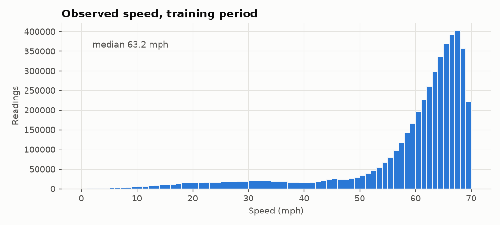

| Percentile | 1 | 5 | 10 | 25 | 50 | 75 | 90 | 99 |
|---|---|---|---|---|---|---|---|---|
| mph | 13.5 | 26.3 | 38.5 | 57.2 | 63.2 | 66.5 | 68.3 | 69.8 |

Below 20 / 30 / 40 / 50 mph: 2.75 % / 6.46 % / 10.49 % / 15.30 % of readings. Most of the time the network is near free flow, and the hard part sits in the left tail.

**Why it matters:** a model that always predicts about 63 mph would already have a small *average* error, so overall MAE alone can hide a model that fails exactly when it matters. MAPE also gets large at low speeds, because the denominator is small. Phase 4 will therefore report errors separately for congested conditions and peak hours.

## 2. Defining congestion

Sensors differ: the per-sensor free-flow speed, taken as the 85th percentile of observed speed (a traffic-engineering convention), ranges from **36.2 to 70.0 mph** (median 66.4). A fixed mph threshold would label a chronically slow sensor as always congested. The working definition is therefore relative:

> **Congested** = speed < 0.6 × that sensor's free-flow speed, with free-flow estimated on training data only.

Under this definition, 9.15 % of training readings are congested. Per sensor, the rate ranges from 0 % to 49.5 % (median 7.0 %). This is an EDA definition. It will be revisited when the dashboard's congestion indicator is designed.

## 3. Daily and weekly patterns

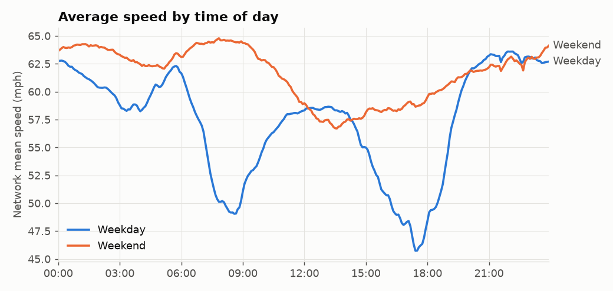

- **Weekday:** AM trough at **08:35 (49.0 mph)**, PM trough at **17:25 (45.7 mph)**, deeper than the AM one. Speed recovers to ~63 mph by 21:00.
- **Weekend:** no commute peaks. A shallow minimum at 13:35 (56.7 mph).

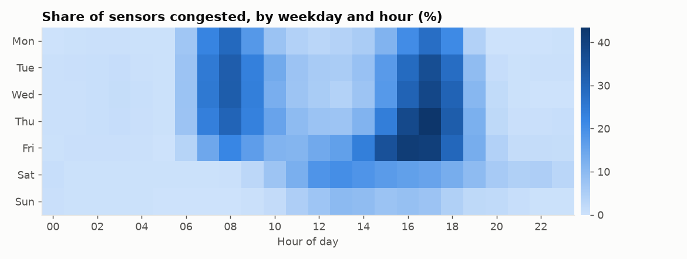

Congestion peaks on **Thursday at 17:00, when 43.4 % of sensors are congested**. Friday's afternoon congestion starts earlier (from about 14:00), and Saturday shows moderate midday congestion. Because of these differences, day of week is a better feature than a binary weekend flag.

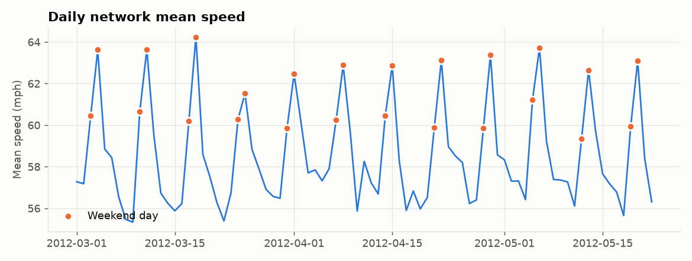

The daily mean speed alternates between weekdays (mean 57.3 mph) and weekends (61.7 mph), with no visible long-term trend across the 12 weeks. The slowest day was Fri 2012-03-09 (55.3 mph), and the fastest was Sun 2012-03-18 (64.2 mph).

## 4. Temporal dependence

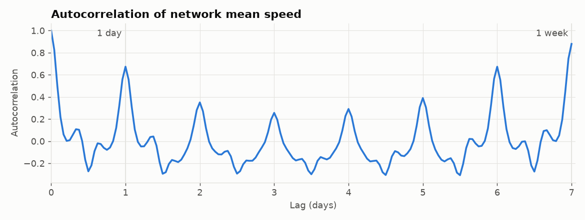

Autocorrelation of the network-mean speed:

| Lag | 5 min | 1 h | 6 h | 12 h | 1 day | 1 week |
|---|---|---|---|---|---|---|
| r | 0.995 | 0.826 | 0.009 | −0.273 | 0.673 | **0.879** |

The **1-week** correlation is higher than the 1-day one. A 1-day lag compares Monday with Sunday and Saturday with Friday, mixing day types, while a 1-week lag always compares like with like. The value at 12 h is negative because 12 hours away from rush hour falls in a quiet period, and vice versa.

**Feature implications:** recent lags (5–60 min) carry the short-term signal. A same-time-yesterday lag (288) and a same-time-last-week lag (2016) carry the seasonality. All of them are known at prediction time.

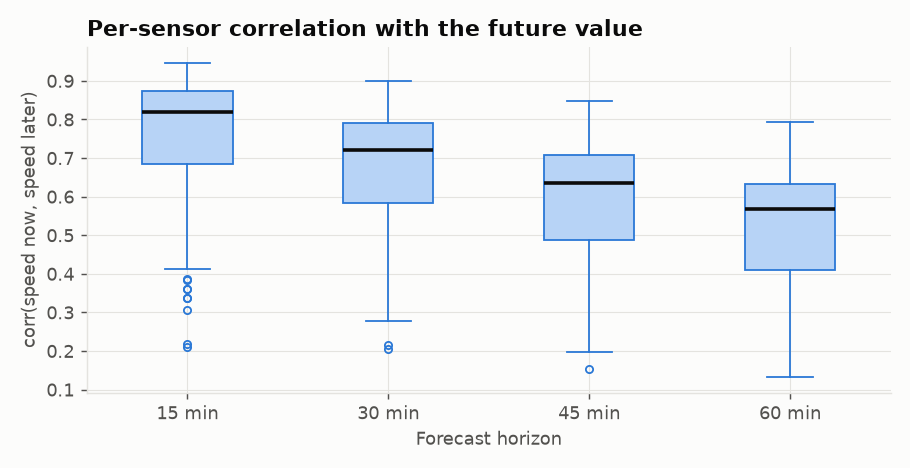

Per-sensor correlation between the current speed and the speed *h* steps later:

| Horizon | 15 min | 30 min | 45 min | 60 min |
|---|---|---|---|---|
| Median across sensors | 0.82 | 0.72 | 0.64 | 0.57 |
| Lowest sensor | 0.21 | 0.21 | 0.15 | 0.13 |

This is roughly how much persistence (predicting "no change") can exploit. The wide spread across sensors means some sensors are much harder to forecast than others, so per-sensor error analysis in Phase 5 is important.

## 5. Spatial structure

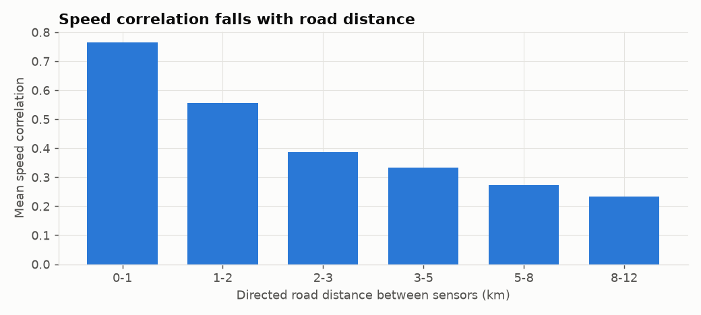

| Directed road distance | 0–1 km | 1–2 | 2–3 | 3–5 | 5–8 | 8–12 |
|---|---|---|---|---|---|---|
| Mean speed correlation | 0.76 | 0.56 | 0.39 | 0.33 | 0.27 | 0.23 |
| Pairs | 142 | 271 | 475 | 1,566 | 4,340 | 4,752 |

`distances.csv` only contains pairs up to 11.9 km apart (11,546 of the 42,642 possible directed pairs). Farther pairs are absent, not zero. Correlation roughly halves within the first 2–3 km, so useful spatial information comes from close neighbours. This is the same locality that the published adjacency matrix encodes (Gaussian kernel, threshold 0.1).

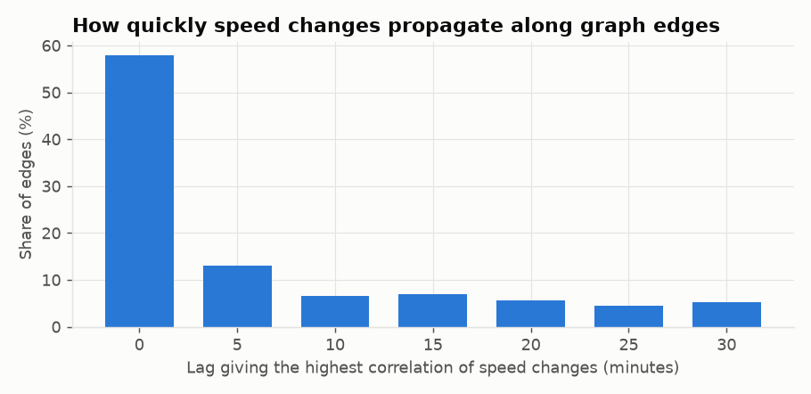

For each of the 1,515 directed graph edges i→j, I correlated *5-minute changes* at i with changes at j up to 30 minutes later. The lag with the highest correlation was **0 for 58 %** of edges and 5 min for another 13 %. However, the correlation of 5-minute changes is weak overall (mean 0.069 at lag 0, about 0 after that): single-step changes are dominated by sensor noise. At this resolution, disturbances mostly appear to propagate within one sampling interval.

**Implication:** for LightGBM, neighbours' current and recent *speed levels*, possibly smoothed, are the promising spatial features. Lead-lag change features are unlikely to add much. Graph models (Phase 6) learn these relationships directly, and the EDA does not show a long propagation delay for them to exploit.

## 6. Sensor-level behaviour

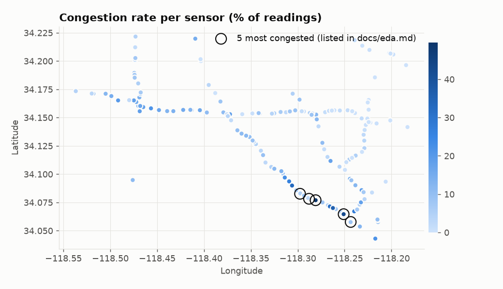

Congestion is strongly localised. The five most congested sensors all sit on one corridor in the south-east of the network, heading toward downtown Los Angeles:

| node_id | sensor_id | Congested (% of readings) |
|---|---|---|
| 12 | 716339 | 49.5 |
| 193 | 717453 | 48.9 |
| 144 | 764853 | 42.5 |
| 187 | 717458 | 42.4 |
| 91 | 773023 | 41.4 |

A quarter of the sensors are congested less than 1.8 % of the time. A single global model must handle both kinds of sensor, so sensor identity (or sensor-level statistics computed on training data) is a candidate feature.

## 7. Congestion episodes

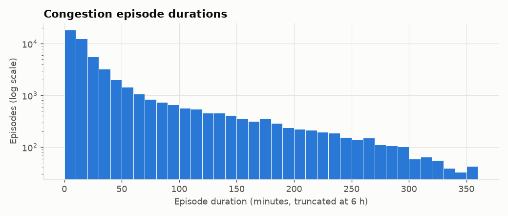

- 52,801 episodes in training. Median duration 15 min, 75th percentile 35 min, maximum 885 min (14.75 h).
- **34.8 % last a single 5-minute step.** These are flickers around the threshold, not real congestion events.
- Episodes of 15 minutes or more start mainly between **14:00 and 18:00 (43.7 %)** and between 06:00 and 08:00 (21.3 %).

The dashboard's congestion indicator should therefore require persistence, for example at least 3 consecutive congested steps, rather than flagging every dip.

## 8. Missing data

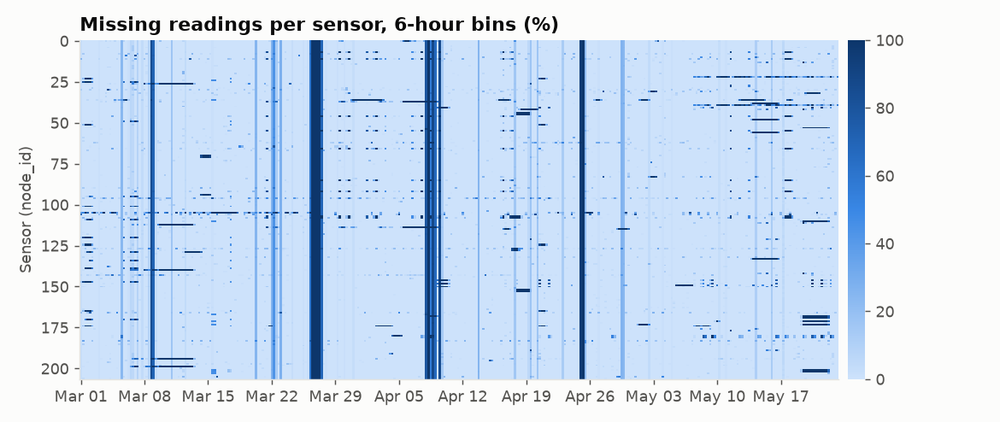

The full-height vertical bands are **network-wide outages**. They are the main source of missing data, as Phase 1 found. The worst days in training are 2012-04-08 (81.6 % missing), 03-27 (67.9 %), 03-26 (65.4 %), 04-25 (54.7 %) and 04-09 (43.2 %). Horizontal streaks are single-sensor outages.

Missingness also varies by time of day: 9.1 % at 00:00–01:59 and 9.1 % at 13:00, against 4.9 % at 20:00. **The data is therefore not missing completely at random.** Consequences:

- Metrics are computed only where the true value is observed, i.e. masked metrics.
- Lag and rolling features must handle gaps explicitly, with NaN-aware statistics and missing-indicator features. Do not forward-fill across multi-hour outages, because that would feed stale values to the model as if they were current.
- LightGBM handles NaN inputs natively, which is one reason to keep NaN and not impute.

## 9. Data-quality checks

- **Very low readings:** the training data contains 2,390 positive readings below 5 mph. Only **7** of them are isolated, meaning both neighbouring readings are above 30 mph. The rest sit inside sustained slow traffic, so they are genuine stop-and-go conditions and **are kept**.
- **Daylight saving (2012-03-11):** the weekday AM trough is at 08:25 before the change and 08:35 after it. There is no 1-hour shift, so timestamps behave as local clock time, and time-of-day features can be computed directly from them.

## 10. Drift check: train vs validation

| | Train | Validation |
|---|---|---|
| Mean speed (mph) | 58.58 | 58.89 |
| Congested (%), using train free-flow | 9.15 | 9.39 |
| Missing (%) | 7.13 | 6.96 |
| Weekday time-of-day profile correlation | – | 0.991 |

The two periods are very similar, so validation scores should be a fair guide for model selection. Note that validation contains Memorial Day (Mon 2012-05-28), which will behave like a weekend. Holidays are a known gap in calendar features. Phase 1 already showed that the test period has more missing data (12.1 %), which makes masked metrics even more important there.

## Open questions for later phases

- Exact congestion definition for the product, including the persistence rule (Phase 8).
- Whether to model holidays. The training period (1 Mar – 23 May 2012) contains no US federal holidays, so the model has no examples to learn holiday behaviour from.
- Per-sensor vs global models (Phase 5). The EDA favours one global model with sensor-level features, given how differently sensors behave and how few samples each sensor has.
