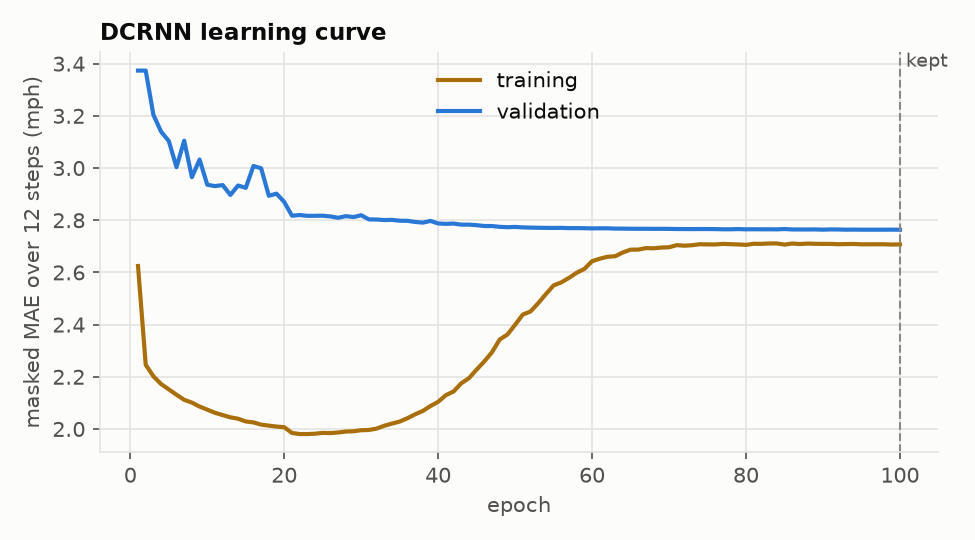

# Model card: DCRNN speed forecaster

Generated by `scripts/train_dcrnn.py` from `models/metrics/dcrnn.json`. Do not edit by hand.

- **Model:** DCRNN (diffusion convolutional recurrent network), one model for all 12 steps; 378,113 parameters; 207 METR-LA sensors on the published directed road graph (random walk in both directions).
- **Code version:** git `6ea897d + uncommitted changes`; seed 0.
- **Training data:** 2012-03-01 00:00:00 → 2012-05-23 06:40:00 (22,964 windows). Validation 2012-05-23 06:45:00 → 2012-06-04 04:05:00 (early stopping). Test 2012-06-04 04:10:00 → 2012-06-27 23:55:00 (scored once).
- **Inputs per sensor and step (last 12 steps):** standardised speed (missing → training mean), missing flag, time of day (sin, cos), weekend flag. The decoder also gets the time features of each target step.
- **Settings:** `{"hidden": 64, "layers": 2, "diffusion_steps": 2, "n_covariates": 3}`; Adam lr 0.01 eps 0.001, x0.1 at epochs [20, 30, 40, 50]; batch 64; float16 autocast + GradScaler; early stopping on validation masked MAE over 12 steps, patience 10, max 100 epochs. Published DCRNN settings, not tuned.
- **Training:** best epoch 100 of 100; 224 min end to end on NVIDIA GeForce RTX 3050 6GB Laptop GPU; GPU peak 1,808 MB; process peak memory 2,252 MB.

## Accuracy (masked; MAPE excludes targets under 5 mph)

| Split | Horizon | MAE | RMSE | MAPE | LightGBM MAE / RMSE | AR baseline MAE / RMSE |
|---|---|---:|---:|---:|---|---|
| validation | 15 min | 2.44 | 4.78 | 6.0% | 2.53 / 4.96 | 3.15 / 5.50 |
| validation | 30 min | 2.80 | 5.84 | 7.4% | 2.92 / 5.93 | 3.59 / 6.45 |
| validation | 45 min | 3.04 | 6.50 | 8.4% | 3.18 / 6.56 | 3.83 / 6.98 |
| validation | 60 min | 3.22 | 6.97 | 9.1% | 3.36 / 6.96 | 3.98 / 7.30 |
| test | 15 min | 2.64 | 5.08 | 6.7% | 2.71 / 5.23 | 3.27 / 5.71 |
| test | 30 min | 3.02 | 6.18 | 8.2% | 3.10 / 6.19 | 3.68 / 6.60 |
| test | 45 min | 3.28 | 6.87 | 9.2% | 3.34 / 6.75 | 3.89 / 7.06 |
| test | 60 min | 3.47 | 7.36 | 9.9% | 3.49 / 7.10 | 4.02 / 7.33 |

## Validation MAE by slice (LightGBM in brackets)

| Horizon | peak | off-peak | congested | free-flowing |
|---|---:|---:|---:|---:|
| 15 min | 3.52 (3.80) | 2.18 (2.22) | 6.40 (7.07) | 2.03 (2.06) |
| 30 min | 4.29 (4.71) | 2.43 (2.48) | 8.57 (9.50) | 2.20 (2.23) |
| 45 min | 4.87 (5.45) | 2.60 (2.64) | 10.08 (11.12) | 2.31 (2.36) |
| 60 min | 5.29 (5.96) | 2.72 (2.74) | 11.17 (12.18) | 2.40 (2.45) |

## Limits

- Trained on 12 weeks of spring 2012 traffic; no holidays, events or weather inputs.
- One seed; published hyperparameters, not tuned for this split.
- Run-to-run variation is not measured.
- Point forecasts only: no prediction intervals.
- Needs a CUDA GPU to train; inference also runs on CPU.
