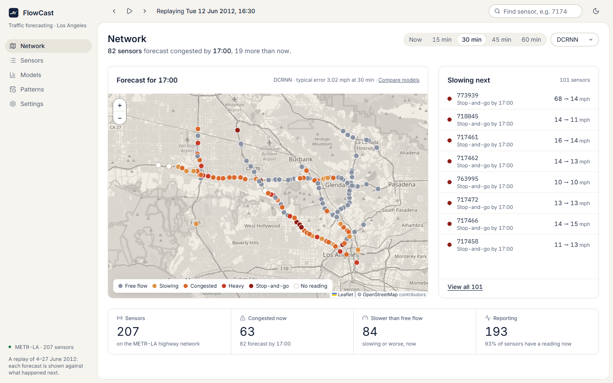

# FlowCast — Phases

The roadmap, one phase at a time. Each phase ends with a report: files changed, verified results, tests actually run, and open issues. Then it stops for review. A phase is **done** only when its exit criteria are met and checked.

Related: [architect.md](architect.md) · [memory.md](memory.md)

| # | Phase | Status | Commit |
|---|---|---|---|
| 0 | Discovery and planning | ✅ done | – |
| 1 | Dataset acquisition and foundation | ✅ done | `736fa89` |
| 2 | Exploratory data analysis | ✅ done | `8665a3b` |
| 3 | Feature engineering | ✅ done | `ea342c8` |
| 4 | Baselines and evaluation framework | ✅ done | see git log |
| 5 | LightGBM | ✅ done | see git log |
| 6 | Graph deep learning (DCRNN) | ✅ done | see git log |
| 7 | Backend (FastAPI) | ✅ done | see git log |
| 8 | Frontend (React) | ✅ done | see git log |
| 9 | Integration and testing | ✅ done | see git log |
| 10 | Deployment and open-source release | ✅ done | see git log |
| 11 | "Paint a jam": in-browser DCRNN sandbox | 📝 proposed | – |
| 12 | Shockwave tracker and corridor diagram | 📝 proposed | – |
| 13 | Honest uncertainty (adaptive conformal intervals) | 📝 proposed | – |
| 14 | Sensor blackout lab and placement | 📝 proposed | – |
| 15 | Why this forecast? (graph attribution) | 📝 proposed | – |
| 16 | Cross-city test on PEMS-BAY | 📝 proposed | – |

**Suggested order after v1.0:** 13 → 12 → 11, then 14, 15, 16. Phase 13 adds error bars that the later phases reuse; 12 delivers the corridor diagram left out of Phase 8; 11 benefits from both. The same rules apply as before: ₹0, no tuning on the test set, numbers only from committed JSON, one report per phase.

---

## Phase 0 — Discovery and planning ✅

- Repository inspected: it was empty. Python 3.12.4 was chosen alongside the system's 3.14. Hardware and the ₹0 budget were recorded as constraints.
- Dataset source verified (`witgaw/METR-LA`, ~223 MB Parquet + sensor graph) before downloading.

## Phase 1 — Dataset acquisition and foundation ✅

**Delivered:** `src/flowcast/data/metr_la.py`, `validation.py`, `scripts/prepare_metr_la.py`, 19 tests, [dataset.md](dataset.md), MIT license.

**Verified results:**
- 207 sensors; 34,272 timestamps at exactly 5-minute spacing (2012-03-01 → 06-27); speeds in mph, with 0 meaning missing.
- Splits: 23,974 / 3,425 / 6,850 samples, in chronological order. Every redundant copy of every reading was checked and agrees exactly.
- Missing: 8.11% overall, mostly from 97 network-wide outage blocks. The test period is worse (12.1%).
- `node_id ↔ sensor_id` mapping is supported by the data: graph neighbours correlate at 0.436, against 0.204 for all pairs.
- Peak RAM 3.3 GB, runtime ~33 s.

## Phase 2 — Exploratory data analysis ✅

**Delivered:** `src/flowcast/data/processed.py`, `src/flowcast/analysis/eda.py`, `scripts/run_eda.py`, 9 tests, [eda.md](eda.md) with 11 figures. Training period only, with validation used once for a drift check. The test set has not been looked at.

**Findings that drive Phase 3:**
- Same time last week correlates more strongly than same time yesterday: 0.88 vs 0.67.
- Predictability decays with horizon: median correlation 0.82 at 15 min, 0.57 at 60 min.
- Spatial correlation falls fast with distance: 0.76 under 1 km, 0.23 at 8–12 km.
- Speed changes mostly reach neighbouring sensors within one 5-minute step.
- Missingness depends on time of day.

---

## Phase 3 — Feature engineering ✅

**Delivered:** `src/flowcast/features/build.py`, `src/flowcast/congestion.py` (shared free-flow definition), `scripts/build_features.py`, 14 tests, [features.md](features.md).

**Verified results:** 48 features (39 per horizon). The leakage test passes and was shown to catch an injected centred-window leak. Lags and targets match the official HF windows on 300 random validation rows. Rows: train 4,677,385 / validation 668,200 / test 1,276,937. Peak RAM 2.27 GB; build time 34 s. The adjacency direction was verified: `A[i,j]` = kernel of the distance from i to j.

### Original plan

**Goal:** a reusable, leakage-proof generator of (sensor, as-of time) feature rows with targets at h = 3, 6, 9, 12 steps.

**Planned features** (every one computed from readings ≤ the as-of time *t*):

| Group | Features | Why (EDA evidence) |
|---|---|---|
| Recent lags | speed at t, t−1, t−2, t−3, t−6, t−12 | 5-min autocorrelation 0.995; 1 h 0.83 |
| Rolling | mean, std, min, max over the last 15 / 30 / 60 min (NaN-aware) | Smooths sensor noise |
| Trend | speed(t) − speed(t−3), speed(t) − speed(t−6) | Is speed dropping into a congestion onset? |
| Seasonal | speed at t+h−288 (same time yesterday) and t+h−2016 (same time last week); also the mean of the last 4 same-weekday values | Weekly correlation 0.88 > daily 0.67. These offsets point to the past only because h ≤ 12 is far smaller than 288. |
| Calendar | time of day (sin/cos), day of week, weekend flag | Two weekday troughs; Friday is different |
| Sensor | node id (categorical), free-flow speed and congestion rate from the training period | Sensors behave very differently (congested 0–49.5% of the time) |
| Spatial | adjacency-weighted mean of neighbours' current and 15-min-mean speeds; the slowest neighbour's speed | Strong correlation within 1–3 km; propagation within one step |
| Missingness | is-missing flags for the current and lag-1 readings; count missing in the last hour | Missingness is informative |

**Rules:** no centred windows; no forward-fill across gaps over 15 min; targets that are missing are masked. A row is kept only if all of its targets fall in one split's owned period.

**Exit criteria:**
1. A feature generator in `src/flowcast/features/` that is deterministic and documented.
2. A **leakage test**: overwrite every reading after *t* with random values, then assert every feature for *t* is unchanged.
3. Alignment tests: feature rows at known timestamps equal hand-computed values.
4. Feature tables written to Parquet as float32, with peak RAM measured and under 8 GB.
5. `docs/features.md`: the feature list, the reason for each feature, and table sizes.

## Phase 4 — Baselines and evaluation framework ✅

**Delivered:** `src/flowcast/evaluation/metrics.py`, `src/flowcast/models/baselines.py`, `scripts/run_baselines.py`, 12 tests, `models/metrics/baselines.json`, [baseline_results.md](baseline_results.md) (generated), [experiments.md](experiments.md).

**Verified results:** the AR-on-residuals baseline is the best at every horizon on MAE and RMSE (validation MAE 3.15 → 3.98 mph from 15 to 60 min). Persistence keeps the best 15-min MAPE. Every baseline passes a future-perturbation leakage test, which was shown to catch two injected lookahead bugs. Runtime 23 s.

### Original plan

- Masked MAE / RMSE / MAPE per horizon. MAPE excludes targets under 5 mph, and the threshold is stated.
- Slices: peak, off-peak, congested, per sensor, by hour.
- Baselines: persistence; historical average by (sensor, day of week, slot) from training data; one statistical model.
- Reported on validation, plus one test-period score per baseline, recorded as the floor to beat.
- **Exit:** a results table built from committed JSON, plus `docs/experiments.md` started.

## Phase 5 — LightGBM ✅

Result: beats the floor at every horizon (validation MAE 2.53–3.36 vs 3.15–3.98); see [experiments.md](experiments.md) §3 and the [model card](model_card_lightgbm.md). Intervals deferred.

- One global model per horizon, on CPU. Compared against a multi-output alternative on validation.
- Hyperparameter search on validation only, with early stopping on validation. The test period is scored once.
- Feature importance (gain plus permutation on validation), error analysis by slice, and the residual distribution.
- Optional: calibrated intervals (quantile objectives or conformal). They are drawn in the UI only if calibration holds on validation.
- Model serialisation and a model card (data period, features, metrics, git commit).
- **Exit:** it beats every baseline on validation at all horizons, or the doc says honestly where it doesn't.

## Phase 6 — Graph deep learning ✅

Result: lowest MAE at every horizon (validation 2.44–3.22, test 2.64–3.47); significantly better than LightGBM up to 45 min, tied at 60 min, and worse on long-horizon RMSE. See [experiments.md](experiments.md) §4, the [comparison](model_comparison.md) and the [model card](model_card_dcrnn.md).

- DCRNN on the published directed adjacency (no invented connectivity). Batch size and hidden size sized for 6 GB VRAM, with mixed precision.
- Same splits, same masked metrics, same test period as LightGBM.
- **Exit:** a side-by-side comparison table. Any improvement is claimed only if the results show it.

## Phase 7 — Backend ✅

Result: nine read-only endpoints serving precomputed replay forecasts from memory (no database); 24 API tests including every 422/404 path; OpenAPI at `/docs`; network forecast p95 4.7 ms uncached over loopback HTTP ([api_latency.json](../models/metrics/api_latency.json)). See [architect.md](architect.md) §6.

- FastAPI with typed schemas, the replay-clock forecast service, sensors / forecast / models / metrics / analytics endpoints, and in-memory caching.
- **Decided:** Parquet-only, precomputed forecasts ([architect.md](architect.md) §6).
- **Exit:** every endpoint tested, including validation errors; OpenAPI docs; p95 latency of the network forecast measured.

## Phase 8 — Frontend ✅

Result: four screens (Network, Sensor, Models, Patterns) on the framed sheet, with the replay clock in the URL; taste-skill inspector 0 FAIL at 1440 / 768 / 390 in light and dark; Lighthouse accessibility 100 on every screen; reduced motion verified. The corridor time-space diagram (stretch) was not built. Changes to the §9 plan: plain CSS instead of Tailwind/shadcn, own SVG charts, greyscale OSM tiles (CARTO now needs a key). See [architect.md](architect.md) §9.

- Built to the design system in [architect.md](architect.md) §10: framed sheet, pill controls, no neon, motion spec, accessibility rules.
- Screens: Network, Sensor, Models, Patterns. Stretch goal: the corridor time-space diagram.
- **Exit:** the taste-skill inspector in app mode at 1440 / 768 / 390 with no FAILs; reduced-motion checked; Lighthouse accessibility ≥ 95.

## Phase 9 — Integration and testing ✅

Result: 21 Playwright flows against the real API and production build (desktop and phone), including error, empty and invalid-URL states; a map performance check (a replay step redraws all 207 markers in 34 ms at p95, 128 ms with the CPU slowed 4×; [frontend_perf.json](../models/metrics/frontend_perf.json)); and a security review with 31 new API tests ([security.md](security.md)). Fixed on the way: echoed input is now cut short, the API sends `nosniff` / `no-referrer` / `DENY` framing headers, entrance animations no longer leave 207 finished animations on the map, and the virtual environment's `setuptools` was upgraded past three advisories.

- End-to-end flows (Playwright), error and empty states against a real backend, a performance check on the 207-marker map, and a security review (CORS, input validation, no filesystem exposure).

## Phase 10 — Deployment and release ✅

Result: a static demo on GitHub Pages (https://lloydaq.github.io/flowcast/) that rebuilds every API answer from exported files (equal to 80 sampled real answers; the 21 end-to-end flows pass against it under a strict CSP); GitHub Actions CI (lint, Python tests, OpenAPI schema check, frontend type-check, tests and builds); a demo GIF in both themes; a v1.0.0 release. Also: the API's `congested` flag now judges the forecast as returned (2 decimals), so a client can reproduce it exactly.

- Reproducible setup docs, a GitHub Actions CI, and a free hosting option (static precomputed demo vs free-tier backend: decide here).
- README with real results, screenshots, a short demo GIF, and a v1.0 GitHub release.

---

# After v1.0 — proposed phases

Nothing below has been started. Each phase must still meet the hard constraints in [memory.md](memory.md): ₹0, the RTX 3050 6 GB, no fabricated results, no training or tuning on the test set.

## Phase 11 — "Paint a jam": in-browser DCRNN sandbox 📝

**Goal:** the static demo runs the real model live. A visitor drags a sensor's current speed down (or paints a slow stretch on the map) and watches the 5–60 min forecast spread through the network. Still no server.

- Check the DCRNN's parameter count and graph-op support first; if the diffusion convolution does not export cleanly, write it with plain matrix products (the support matrices are fixed).
- Export to ONNX (opset pinned), run with ONNX Runtime Web (WASM; WebGPU only if available). Load the model lazily so the existing screens do not get slower.
- Sandbox screen: start from a real replay window, edit inputs, show forecast vs the untouched forecast side by side. Label it clearly as a what-if, not a measurement.
- Fits the static CSP (`wasm-unsafe-eval` only if ORT needs it; recorded in [security.md](security.md)).
- **Exit:** browser output matches PyTorch within 0.01 mph on 200 sampled test windows; one forecast step p95 < 100 ms on the desktop and measured (reported, not gated) on a throttled phone profile; Lighthouse accessibility stays ≥ 95; e2e flow for the sandbox in `e2e:static`.

## Phase 12 — Shockwave tracker and corridor diagram 📝

**Goal:** detect congestion wave fronts moving upstream along the directed graph, measure their speed, and project where each front will be in 30 min. Builds the corridor time-space diagram left out of Phase 8.

- Corridors: ordered chains of sensors along the published directed adjacency (no invented links); document how they were chosen.
- Front detection on the training period: onset of congestion (the shared definition in `congestion.py`) propagating sensor to sensor; wave speed from a robust fit over (distance, onset time).
- Projection: extend the fitted front 15/30 min ahead; compare with the DCRNN's own forecast of where congestion will be.
- UI: time-space diagram per corridor (speed as the single red ramp), fitted fronts as lines, projection dashed.
- **Exit:** the distribution of measured wave speeds reported with its spread and compared, as a sanity check, with values in the traffic-flow literature (cited); projected front positions scored on validation, then once on test, against a "front stays where it is" baseline; the diagram passes the inspector at 1440 / 768 / 390.

## Phase 13 — Honest uncertainty (adaptive conformal intervals) 📝

**Goal:** prediction intervals the UI can show without misleading anyone. Closes the item deferred in Phase 5.

- Split conformal per horizon on validation residuals, then an adaptive variant (e.g. adaptive conformal inference) that updates as the replay advances, since missingness and behaviour shift between periods.
- Report coverage and width by slice: horizon, peak / off-peak, congested, high-missingness sensors.
- UI: interval band on the Sensor screen; a "trust map" layer shading sensors by interval width. Drawn only where calibration holds.
- **Exit:** 90% intervals cover 88–92% on validation for every horizon; coverage per slice reported, with any failing slice named in the docs and hidden or flagged in the UI; test coverage computed once and recorded.

## Phase 14 — Sensor blackout lab and placement 📝

**Goal:** measure how forecasts degrade when sensors go dark, then answer "if the city could keep only N sensors, which ones?"

- Knock-out schemes: random, worst-case (greedy), and replaying the real outage patterns from the test period onto other days.
- Models scored as-is on the remaining inputs (no retraining), plus one retrained point to show the gap.
- Placement: greedy selection of the sensors whose removal hurts validation MAE least; stability checked across bootstrap resamples.
- **Exit:** curve of MAE vs sensors kept, with 95% day-block bootstrap intervals; a ranked keep-list with its stability; all choices made on validation, test scored once for the final list.

## Phase 15 — Why this forecast? (graph attribution) 📝

**Goal:** show which upstream sensors and time steps drove a forecast, as arrows on the map.

- Integrated gradients on the DCRNN (baseline input documented: e.g. the historical average, not zeros, since 0 means missing).
- Aggregate to per-sensor, per-lag attributions; precompute for the static demo at the replay times it offers.
- **Exit:** a deletion test — removing the top-k attributed inputs changes the forecast more than removing k random ones (and more than removing the k nearest), with bootstrap intervals; attributions are consistent with the graph direction (upstream dominates) or the docs say where they are not.

## Phase 16 — Cross-city test on PEMS-BAY 📝

**Goal:** does a model trained on Los Angeles work in the Bay Area?

- Acquire PEMS-BAY (325 sensors) from a free source, verified like Phase 1 (units, missingness, adjacency direction) before use; record it in [dataset.md](dataset.md).
- Zero-shot: LightGBM features are sensor-agnostic except the node id and per-sensor statistics (recomputed from PEMS-BAY training data); DCRNN weights are size-independent of the node count, run on the new adjacency.
- Fine-tuned: a small number of epochs on PEMS-BAY training data, within the 6 GB budget.
- Baselines from Phase 4 run on PEMS-BAY for the floor.
- **Exit:** same masked metrics, same rows-for-all-models rule and same day-block bootstrap; a table of zero-shot vs fine-tuned vs trained-from-scratch-in-budget, and an honest verdict.
